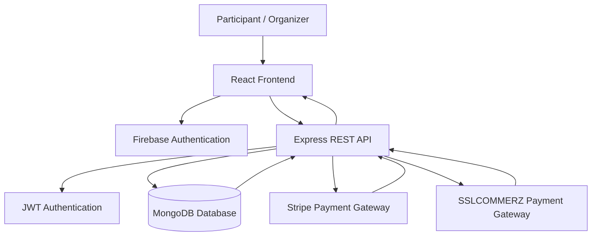
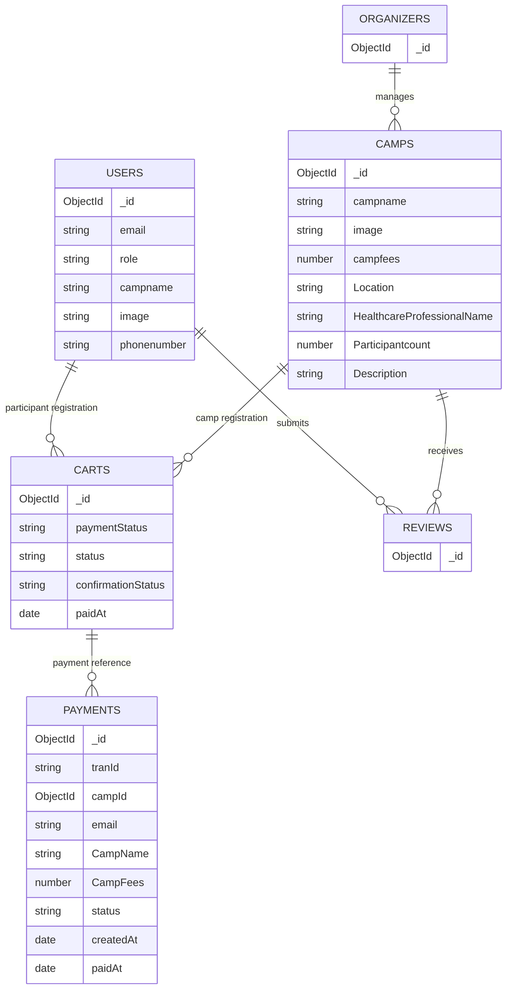
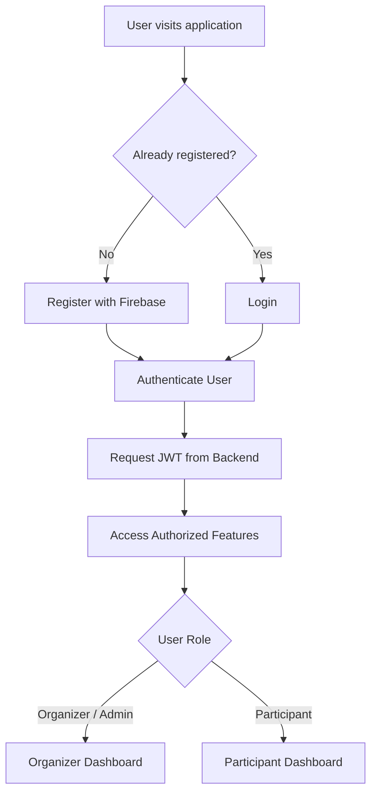
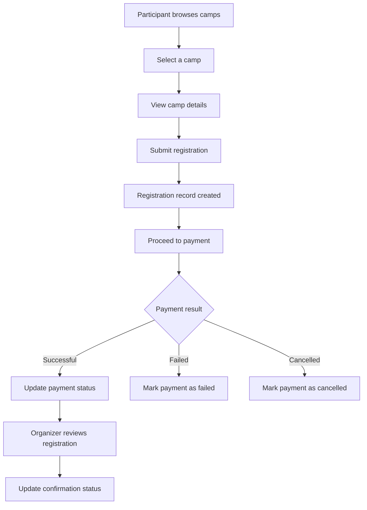
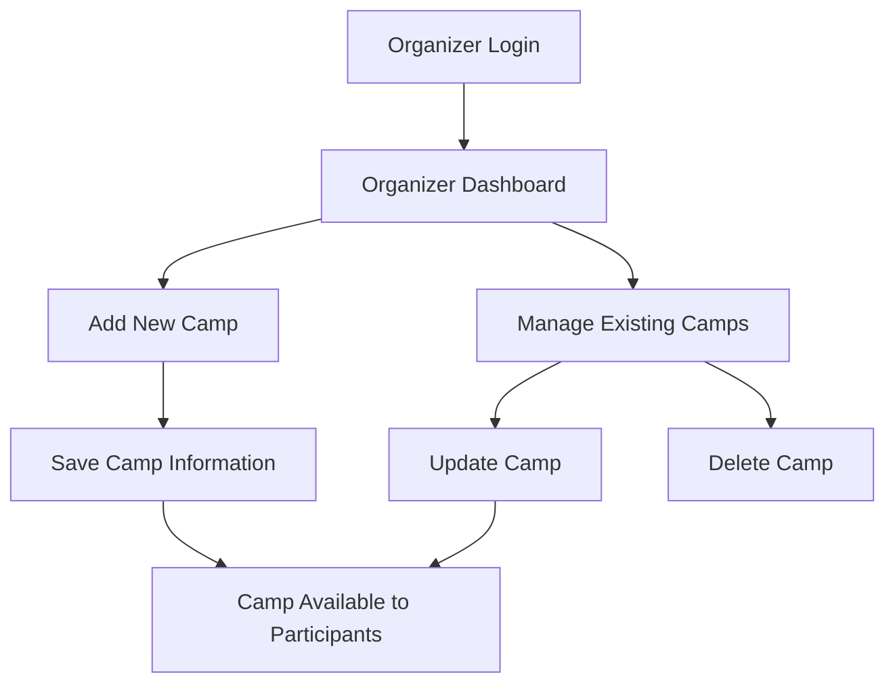
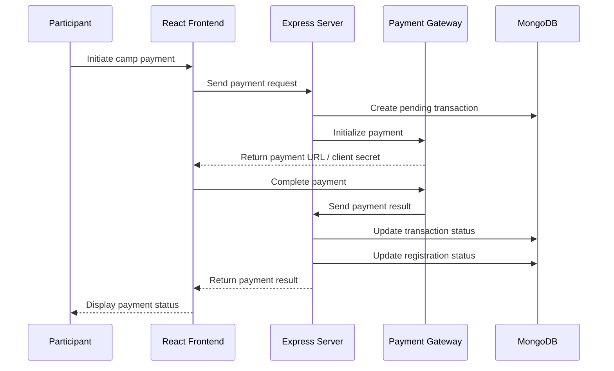

# MediCamp – Medical Camp Management System

MediCamp is a web-based Medical Camp Management System designed to connect healthcare organizers with participants through a centralized platform. It simplifies medical camp discovery, registration, payment processing, participant management, and feedback collection.

The application provides separate dashboards for organizers and participants, making it easier to manage medical events and monitor participation.

## Project Repositories

- **Client:** [MediCamp Client](https://github.com/Shafaet1074/MediCamp_Client)
- **Server:** [MediCamp Server](https://github.com/Shafaet1074/Medicamp-server)

## Key Features

### General Features
- Responsive homepage with featured and popular medical camps.
- Browse and search available medical camps.
- Sort camps by registration count, fees, and alphabetical order.
- View detailed camp information, including location, healthcare professional, fees, and schedule.
- User registration and login with Firebase authentication.

### Organizer Dashboard
- Manage organizer profile information.
- Create, update, and delete medical camps.
- View and manage camp registrations.
- Monitor participant and payment information.
- Manage participant confirmation status.

### Participant Dashboard
- View registered medical camps.
- Manage participant profile information.
- Complete camp registration and payments.
- View payment history.
- Submit feedback and ratings.
- View participation analytics through charts.

### Payment Management
- Online payment integration using Stripe.
- Bangladesh payment gateway integration using SSLCOMMERZ.
- Store transaction information and payment status.
- Track successful, failed, and cancelled transactions.

## Project Objectives

- Digitize the management of medical camps.
- Provide a centralized platform for healthcare event discovery.
- Simplify participant registration and payment processes.
- Help organizers manage camps and participants efficiently.
- Maintain registration, payment, and feedback records.
- Improve transparency and accessibility in medical camp management.

## Technology Stack

| Category | Technologies |
|---|---|
| Frontend | React.js, Vite |
| Styling | Tailwind CSS, DaisyUI, Ant Design |
| Routing | React Router DOM |
| State / Data Fetching | TanStack React Query |
| Forms | React Hook Form |
| Backend | Node.js, Express.js |
| Database | MongoDB |
| Authentication | Firebase Authentication, JWT |
| Payment | Stripe, SSLCOMMERZ |
| Charts | Recharts |
| HTTP Requests | Axios |
| Notifications | SweetAlert2 |
| Deployment | Firebase Hosting, Vercel |

## System Architecture



## Database Design

MediCamp uses **MongoDB** with a database named `MediCamp`.

The backend code identifies the following collections:

| Collection | Purpose |
|---|---|
| `users` | Stores user information, email, and role |
| `organizers` | Stores organizer-related records |
| `Camps` | Stores medical camp information |
| `carts` | Stores camp registration-related records |
| `payments` | Stores payment and transaction information |
| `Reviews` | Stores participant feedback and ratings |

### 1. Users Collection

Stores registered user information and role details.

| Field | Description |
|---|---|
| `_id` | MongoDB document identifier |
| `email` | User email address |
| `role` | User role, such as admin |
| `campname` | Camp-related profile information |
| `image` | Profile image |
| `phonenumber` | Contact number |

### 2. Camps Collection

Stores information about medical camps created by organizers.

| Field | Description |
|---|---|
| `_id` | Camp document identifier |
| `campname` | Name of the medical camp |
| `image` | Camp image |
| `campfees` | Registration fee |
| `Location` | Camp location |
| `HealthcareProfessionalName` | Assigned healthcare professional |
| `Participantcount` | Number of participants |
| `Description` | Camp description |

### 3. Organizers Collection

Stores organizer-related records. The available backend code exposes an endpoint to retrieve organizer records, but does not establish the complete document structure.

### 4. Carts Collection

Stores camp registration-related information and payment/confirmation states.

Fields referenced by the backend include:

| Field | Description |
|---|---|
| `_id` | Registration document identifier |
| `paymentStatus` | Payment status |
| `status` | Registration/payment state |
| `confirmationStatus` | Organizer confirmation state |
| `paidAt` | Payment completion time |

Other registration fields may be stored in the documents, but their complete structure is not established by the available backend source.

### 5. Payments Collection

Stores payment transaction records.

| Field | Description |
|---|---|
| `_id` | Payment document identifier |
| `tranId` | Transaction identifier |
| `campId` | Related registration document reference |
| `email` | Participant email |
| `CampName` | Camp name |
| `CampFees` | Payment amount |
| `status` | Pending, paid, failed, or cancelled |
| `createdAt` | Transaction creation time |
| `paidAt` | Successful payment time |

### 6. Reviews Collection

Stores feedback and ratings submitted by participants. The complete review document structure is not confirmed by the available backend code.

## Entity Relationship Diagram

The following diagram represents the logical relationships between the main data entities. MongoDB stores documents rather than enforcing traditional SQL foreign-key constraints.



> **Note:** The diagram illustrates the intended application relationships. Not all relationships or fields are explicitly enforced or fully defined in the inspected backend code. In particular, the user-to-registration, camp-to-registration, and review relationships should be verified against the actual MongoDB documents.

## Application Workflows

### 1. Authentication Workflow



### 2. Medical Camp Registration Workflow



### 3. Organizer Camp Management Workflow



### 4. Payment Workflow



## Backend API Overview

The backend exposes REST API endpoints for the main application operations.

| Module | Example Endpoints | Purpose |
|---|---|---|
| Authentication | `POST /jwt` | Generate JWT |
| Users | `/users` | Create and retrieve users |
| User Roles | `/users/admin/:id` | Update user role |
| Camps | `/camps` | Retrieve and manage camps |
| Camp Details | `/campdetails/id/:id` | Retrieve individual camp |
| Registrations | `/carts` | Manage registration records |
| Reviews | `/reviews` | Submit and retrieve reviews |
| Payments | `/payments` | Store and retrieve payment records |
| Stripe | `/create-payment-intent` | Initialize Stripe payment |
| SSLCOMMERZ | `/ssl-payment` | Initialize SSLCOMMERZ payment |
| Organizers | `/organizers` | Retrieve organizer records |

## Getting Started

### Prerequisites

- Node.js
- npm
- MongoDB database
- Firebase project
- Stripe account (if using Stripe)
- SSLCOMMERZ credentials (if using SSLCOMMERZ)

### 1. Clone the Repositories

```bash
git clone https://github.com/Shafaet1074/MediCamp_Client.git
git clone https://github.com/Shafaet1074/Medicamp-server.git
```

### 2. Install Dependencies

Frontend:

```bash
cd MediCamp_Client
npm install
npm run dev
```

Backend:

```bash
cd Medicamp-server
npm install
npm start
```

### 3. Environment Configuration

Configure the required environment variables in the respective `.env` files.

Backend configuration includes:

```env
PORT=
DB_USER=
DB_PASS=
ACCESS_TOKEN=
STRIPE_SECRET_KEY=
STORE_ID=
STORE_PASSWORD=
SSL_MODE=
BACKEND_URL=
```

Frontend configuration should include the Firebase settings and backend API URL required by the application.

**Important:** Use your own credentials. Never commit API keys, database passwords, payment secrets, or private tokens to GitHub.

## Future Improvements

- Implement more comprehensive role-based authorization.
- Improve registration and payment validation.
- Add stronger data validation and error handling.
- Add detailed camp attendance and reporting features.
- Improve database indexing and query performance.
- Add automated testing and API documentation.

## Author

**Shafaet Hossain**

GitHub: [Shafaet1074](https://github.com/Shafaet1074)
